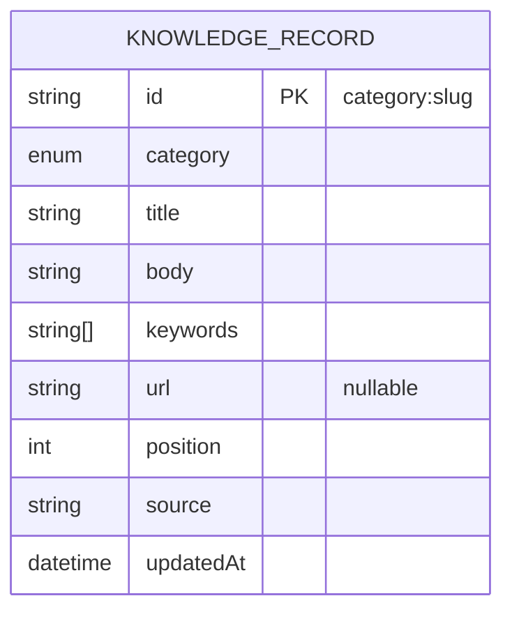

# SCHEMA.md — Shape and rules of the data

**This is documentation, not the executable schema.** The database that actually runs is defined by `prisma/schema.prisma` and committed `prisma/migrations/`. If this document and those files ever differ, **the Prisma files win** and this document must be corrected in the same task.
**Status labels:** CONFIRMED · RECOMMENDED · ASSUMPTION · OPEN DECISION · BLOCKED.
**Nothing here is created yet.** The model below is a **proposal** to be finalized in TASK-017 (OD-03). SQL snippets are illustrative and run only by a task that authorizes it.

---

## 1. Data ownership and sources of truth

| Data | Source of truth | Consumers |
|---|---|---|
| All portfolio content (text, links, order) | **`src/data/*.ts`** (typed modules, Zod-validated) — human-maintained, version-controlled | Server-rendered UI; seed; snapshot |
| Chatbot-searchable facts | **PostgreSQL `KnowledgeRecord`** — a **derived, one-way copy** of the VERIFIED content, written only by the trusted seed | `POST /api/chat` (read-only) |
| Build-time facts snapshot | **`src/lib/server/knowledge.snapshot.json`** — content-identical derived artifact of `VERIFIED` records generated at `prebuild` (ADR-015) | Cold cache fallback during Neon compute wake-up |
| Executable DB definition | `prisma/schema.prisma` + migrations | Prisma Client, migrations |
| Images/CV | Files under `public/assets/` (DB stores **paths only**, never binaries) | UI |

Flow (one direction only): `src/data/` → validate + keep `VERIFIED` → `prisma/seed.ts` (privileged, local) → PostgreSQL → read-only retrieval (shielded by 12-hour SWR in-memory cache and `knowledge.snapshot.json` fallback, ADR-015). **The database is never edited by hand, never written by the running site, and never read by the static sections** (ADR-007).

## 2. Verification model (applies to every content record in `src/data/`)

| State | Meaning | Shown on site? | Seeded to DB? |
|---|---|---|---|
| `VERIFIED` | Owner explicitly confirmed (chat message or direct edit; date noted in a comment) | Yes | **Yes** |
| `DRAFT` | Value seen in a design/provided informally, not yet confirmed | Dev only; **blocks release** | **No** |
| `NOT_PROVIDED` | Missing; carries `[OWNER TO PROVIDE]` | No (non-link/unavailable state at most); **blocks release** | **No** |

This is what keeps unverified or mock facts away from the chatbot. A `verified` column in the DB is **not** needed because only verified rows ever reach it.

## 3. Proposed model — `KnowledgeRecord` (RECOMMENDED, single table)

**Why one table.** The corpus is a few dozen short records; the chatbot only needs `category`, searchable text and an optional URL. One table gives bounded, predictable queries and a trivial seed. Per-entity tables (Profile, Education, Experience, Skill, Project, Certification, Gallery, Contact) were considered and rejected for V1.0: more migrations, joins and seed code with no retrieval benefit. Revisit only if retrieval needs relational filters.

```prisma
// ILLUSTRATIVE ONLY — final form is prisma/schema.prisma (TASK-017)
enum KnowledgeCategory {
  PROFILE
  EDUCATION
  EXPERIENCE
  SKILL
  PROJECT
  CERTIFICATION
  GALLERY
  CONTACT
}

model KnowledgeRecord {
  id        String            @id                 // stable key, e.g. "project:stacklab"
  category  KnowledgeCategory
  title     String                                  // searchable, shown to the model
  body      String                                  // chatbot-safe fact text
  keywords  String[]                                // lowercase search tokens
  url       String?                                 // approved public URL / mailto only
  position  Int               @default(0)           // order within category
  source    String                                  // originating data module, e.g. "projects"
  updatedAt DateTime          @updatedAt

  @@index([category, position])
  @@index([keywords], type: Gin)
}
```

### 3.1 Relations
**None by design** (no foreign keys). Cross-references (e.g. a project's technologies) are stored as `keywords`, not as related rows. This avoids duplicating biography facts across unrelated rows.



### 3.2 Data dictionary
| Field | Type | Req. | Meaning | Constraints |
|---|---|---|---|---|
| `id` | text PK | yes | Stable logical key `"<category-lowercase>:<slug>"` | `^[a-z]+:[a-z0-9-]+$`; prefix must equal the category; immutable once published (renaming = delete + create) |
| `category` | enum | yes | Retrieval category | One of the 8 values |
| `title` | text | yes | Record name | 1–160 chars; no control chars |
| `body` | text | yes | The only text the model may use as fact | 1–2,000 chars; plain text; public facts only |
| `keywords` | text[] | yes (may be empty) | Lowercase tokens for `hasSome` search (technologies, synonyms) | ≤ 20 items, each 2–40 chars, lowercase |
| `url` | text | no | Approved public URL (https) or `mailto:` for the approved email | Valid URL; allowed schemes `https`, `mailto` |
| `position` | int | yes | Order within category | ≥ 0 |
| `source` | text | yes | Which data module produced it (supports pruning/traceability) | Non-empty |
| `updatedAt` | timestamptz | auto | Last write by the seed | Managed by Prisma |

### 3.3 Indexes (only where a real query needs them)
- `(category, position)` — category-filtered, ordered retrieval.
- GIN on `keywords` — `hasSome` token search.
- **No** index on `title`/`body` and **no** `pg_trgm`/extensions: with a few dozen rows, case-insensitive `contains` over a sequential scan is fast and avoids extension setup. Revisit only if measured slow.

### 3.4 Uniqueness policy
`id` is the only uniqueness rule (it encodes the logical identity). Do **not** add unique constraints on `url` or `title` unless a real rule appears (two records may legitimately share a URL such as the GitHub profile).

## 4. Data file → record mapping (what the chatbot can see)

| Data module (`src/data/`) | Produces `KnowledgeRecord` | Notes |
|---|---|---|
| `profile.ts` | 1 × `PROFILE` (`profile:main`) | Headline + approved summary + focus areas |
| `journey.ts` | `EDUCATION` and `EXPERIENCE` records, one per entry (`education:<slug>`, `experience:<slug>`) | Organizations/learning go under `EXPERIENCE` unless the owner prefers otherwise |
| `skills.ts` | **Grouped** `SKILL` records per category (e.g. `skill:languages`, `skill:networking`) | Grouping keeps "What are his skills?" inside the K≤6 retrieval cap |
| `projects.ts` | 1 × `PROJECT` per project | If projects exceed K, revisit the cap in TASK-020 |
| `certifications.ts` | 1 × `CERTIFICATION` per credential | Title, issuer, date/status **only if verified** |
| `gallery.ts` | `GALLERY` records **only** for captions the owner confirmed | Optional |
| `contacts.ts` | 1 × `CONTACT` per approved public channel | Only channels approved for publication (OD-11) |
| `site-config.ts` | — | Navigation, CV path, metadata: not chatbot data |
| `chatbot-knowledge.ts` | The **pure function** `buildKnowledgeRecords()` that derives all of the above, plus clearly flagged `supplemental` facts that exist nowhere else | Must not become a second hand-edited copy |

**Never stored or sent to the model:** secrets, private addresses, phone numbers, ID/account numbers, internal verification notes, DRAFT/NOT_PROVIDED values, image binaries.

## 5. Content module field reference (for `src/data/`, TASK-008)

Common to every item: `id` (slug), `verification` (`VERIFIED` | `DRAFT` | `NOT_PROVIDED`), `position`.

| Module | Fields (beyond the common ones) |
|---|---|
| `profile` | `name`, `headline`, `summary`, `focusAreas[]`, `location?`, `portraitPath` |
| `journey` | items: `kind` (`education`/`experience`/`organization`/`learning`), `title`, `organization`, `period` (display string), `description`, `chips[]?` |
| `skills` | `name`, `group`, `iconPath` or icon key, `visibleLabel?` (per C-04) |
| `projects` | `title`, `summary`, `technologies[]`, `coverPath?`, `repoUrl?`, `repoVisibility` (`PUBLIC`/`PRIVATE`), `demoUrl?`, `status?`, `license?` (the last two only if verified — C-06), `linkStatus` (`VERIFIED`/`NOT_PROVIDED`/`UNDER_REVIEW`) |
| `certifications` | `title`, `issuer`, `description?`, `issuedLabel?`, `imagePath` (full image), `credentialUrl?` |
| `gallery` | `imagePath`, `alt`, `title?`, `caption?` (only if confirmed) |
| `contacts` | `type` (`email`/`linkedin`/`github`/`instagram`/`credly`), `label`, `displayText`, `href` (https:// Gmail compose or profile URL), `approvedForPublic` (bool) (5 records per CR-003, updated CR-007) |
| `site-config` | navigation entries (labels per C-02), `cvPath`, `cvDownloadName`, site metadata |

## 6. Validation responsibilities

| Layer | Responsibility |
|---|---|
| Zod on content modules (build/test time) | Shapes, lengths, URL schemes, ids, no `[OWNER TO PROVIDE]` in anything marked `VERIFIED`, referenced asset files exist |
| Zod in the seed (before **any** write) | Re-validates the derived records; **aborts the whole run on the first invalid record** (no partial seed) |
| Privacy lint in the seed (RECOMMENDED) | Rejects bodies containing patterns for private data (phone-like numbers, "address", "passport", "NIK"…) |
| Zod in `/api/chat` | Request shape and message length (`ARCHITECTURE.md` §7) |
| Database | Types/nullability/PK only. It is **not** the validator for content meaning |
| Release gate | No `DRAFT`, `NOT_PROVIDED` or `[OWNER TO PROVIDE]` remains in shipped data (RULES R-016) |

## 7. Seed, idempotency, update and delete behavior

1. **Trusted tooling only:** `prisma/seed.ts` runs on the developer machine with `MIGRATION_DATABASE_URL`. It is never exposed over HTTP and never deployed as a runtime path.
2. **Pre-flight:** print the target (host + database name, credentials redacted) and require an explicit confirmation flag matching the database name. Production seeding is allowed **only** inside a task that says so (TASK-026) after environment verification (R-040…R-046).
3. **Validate everything first, then write** inside one transaction (all-or-nothing).
4. **Idempotent upsert by `id`:** re-running creates no duplicates and does not change row count or content (only `updatedAt` may move, or skip unchanged rows).
5. **Updated item:** edit the data file → re-run seed → row updated.
6. **Removed item:** deletions are **not** automatic. `--prune` (opt-in, with the same confirmation) lists, then deletes records whose `source` was processed but whose `id` is no longer produced. Default is upsert-only.
7. **Never** use reset/force commands against a non-disposable database (RULES §Database).
8. Ordinary content updates (seed) are separated from schema changes (migrations).

Acceptance (TASK-018): run seed twice → identical row count/content; seed with an invalid record → nothing written; `--prune` dry-run lists only the expected rows.

## 8. Runtime read-only permission model

Two credentials, same database (CONFIRMED policy):

| Role | Used by | Privileges |
|---|---|---|
| **Privileged / migration** (`MIGRATION_DATABASE_URL`) | Local `prisma migrate`, `prisma/seed.ts` only | DDL + write |
| **Runtime read-only** (`DATABASE_URL`) | The deployed Route Handler | `CONNECT`, `USAGE` on schema, `SELECT` on `"KnowledgeRecord"` — nothing else |

Illustrative setup, executed once by TASK-018 with the privileged credential (verify provider specifics first — OD-07; on Neon, roles created through the console may carry broader privileges than roles created with SQL, so prefer `CREATE ROLE` in SQL and **prove** the result with the negative test):

```sql
-- ILLUSTRATIVE — adapt names; never paste real passwords into Markdown or commits
CREATE ROLE portfolio_runtime LOGIN PASSWORD '<generated, stored only in env>';
GRANT CONNECT ON DATABASE <db_name> TO portfolio_runtime;
GRANT USAGE ON SCHEMA public TO portfolio_runtime;
GRANT SELECT ON TABLE "KnowledgeRecord" TO portfolio_runtime;
ALTER ROLE portfolio_runtime SET statement_timeout = '3s';
ALTER ROLE portfolio_runtime SET default_transaction_read_only = on;  -- defense in depth, NOT the boundary
```
**The boundary is the absence of privileges**, not the session setting.

**Re-grant rule:** after any migration that creates or replaces the table, re-check that `portfolio_runtime` still has `SELECT` and nothing more.

**Mandatory negative test (TASK-018, again in TASK-025):** using the *runtime* credential, each of `INSERT`, `UPDATE`, `DELETE`, `TRUNCATE`, `CREATE TABLE`, `DROP TABLE` must fail with a permission error, and `SELECT` must succeed. Record sanitized evidence (no credentials in logs).

## 9. Migration process and environment separation
- Schema changes are deliberate, versioned, reviewable SQL migrations committed to Git. Migration files are never edited after being applied.
- **Development:** a separate development database or provider branch (RECOMMENDED; confirm it fits the free tier — OD-07). Use the interactive dev migration flow only here.
- **Production:** apply committed migrations with the **non-interactive deploy** command only, from a local shell with the privileged credential, after confirming the target. No resets, no `db push --force-reset`, no schema drift fixes by hand.
- If only one database is available, using dev-only commands against it is an **OPEN DECISION** that must be settled with the owner before TASK-017.
- Keep Prisma Client and the migration tooling on the same version; follow current docs for datasource/URL configuration.

## 10. Knowledge context, snapshot parity and retrieval rationale (CR-010 / CR-011 / ADR-013 / ADR-015)
Per CR-010, CR-011, ADR-013, and ADR-015:
- Retrieval uses `loadKnowledge()` backed by an in-memory **Stale-While-Revalidate (SWR) cache** (12-hour TTL) with asynchronous non-blocking background revalidation.
- On cold server starts, the database query is raced against a **600ms timer**. If Neon PostgreSQL compute is asleep after idle (>600ms wake-up) or closed, the server immediately serves the build-time **`knowledge.snapshot.json`** (`source=snapshot`) while the background DB query wakes up.
- Automated tests prove that `knowledge.snapshot.json` is content-identical to `buildKnowledgeRecords()` for all `VERIFIED` records.
- Common starter-chip and identical 0-history questions are served in `< 150ms` from a 30-minute in-memory LRU Answer Cache (`answerCache=hit`, 0 AI calls).
- The total verified knowledge context remains strictly bounded by the hard cap of **40,000 characters** (`TOTAL_KNOWLEDGE_MAX_CHARS`). Both the seed script and unit tests enforce this cap prior to transaction. Grounded output is verified server-side via structured output schema and valid record citation IDs (R-031).

## 11. Schema decisions record (Resolved in TASK-017)
| ID | Item | Status | Resolution |
|---|---|---|---|
| SCH-01 | Final model shape (single table confirmed vs split) | **RESOLVED** | Single table `KnowledgeRecord` confirmed and implemented in `prisma/schema.prisma` with applied migration `20261023072807_init`. |
| SCH-02 | Whether `GALLERY` records are useful to the chatbot | **RESOLVED** | Confirmed in enum `KnowledgeCategory`. Captions included only for verified gallery items if confirmed. |
| SCH-03 | Dev/prod database separation under free-tier limits | **RESOLVED** (OD-07) | Verified on 2026-10-23: Neon Free Tier supports up to 10 branches on 1 project (0.5 GiB, autosuspend). Active development database on AWS `us-east-2` with unpooled direct `MIGRATION_DATABASE_URL` and pooled `DATABASE_URL`. |
| SCH-04 | Exact statement timeout and connection-pool settings | **RESOLVED** | Role-level `statement_timeout = '3s'` enforced on runtime role; PgBouncer connection pooler on `-pooler` host with `sslmode=require`. |
